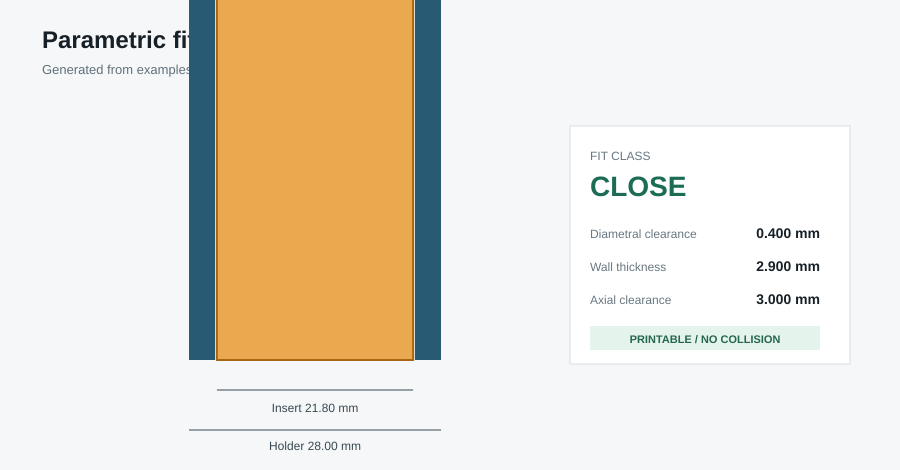

# Parametric Fit Validation Lab

A small geometry-engineering lab for designing and validating cylindrical 3D-printed fits without proprietary models or third-party reference images.



## What it does

- Reads a dimensioned JSON specification.
- Calculates diametral, radial and axial clearance.
- Classifies interference, press, close and free fits.
- Enforces a minimum printable wall thickness.
- Generates watertight holder and reference-insert STL meshes.
- Checks manifold edge counts before accepting the output.
- Produces a machine-readable report and an SVG engineering view.

## Run

```bash
python -m pip install -e .
python -m fitlab.cli examples/close-fit.json --output generated
```

Generated files:

- `holder.stl`
- `insert.stl`
- `fit-report.json`
- `fit-analysis.svg`

## Test

```bash
python -m pip install pytest
pytest -q
```

## Design boundary

This public lab was rebuilt around a neutral cylindrical insert. It does not include branded product references, downloaded marketplace images, private Blender files or customer geometry.

## License

MIT
